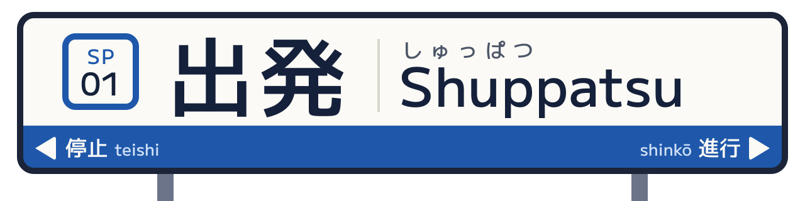

<picture>
  <source media="(prefers-color-scheme: dark)" srcset="assets/logo/header-dark.svg">
  
</picture>

# Shuppatsu

**Shuppatsu** (出発): an open-source engine for playing **Densha de GO! 2 Kōsoku-hen
3000-bandai** (電車でGO！２ 高速編 ３０００番台) from your own disc, written from scratch in Rust
for Linux and Windows. The routes, models, textures, sounds, music and the original's own
tables are read from the disc's files at runtime.

It is a new engine. It is not an emulator, not a wrapper around the original exe and not a
patch, and it needs neither Windows nor Wine on Linux. **No game files are included.** It is an
unofficial fan project, not affiliated with the game's publishers (see [Legal](#legal)).

*About the name:* 出発 (*shuppatsu*, "departure") is the first word of 出発進行
(*shuppatsu shinkō*), the call a Japanese driver makes when the starting signal clears.

<!-- Screenshots: images of the running game are derived from game data, so they are not
     committed to this repository (see "Legal"). Link to externally hosted ones here. -->

## Contents

* [The original game](#the-original-game)
* [Why a new engine](#why-a-new-engine): the original's limitations and what this one adds
* [Status](#status)
* [Getting started](#getting-started): extracting your disc, installing a release, first start
* [Controls](#controls)
* [Settings](#settings): every option, with what the original did
* [Troubleshooting](#troubleshooting)
* [Building from source and development](#building-from-source-and-development)
* [Legal](#legal), [About the use of AI](#about-the-use-of-ai), [Credits](#credits),
  [License](#license)

## The original game

**Densha de GO! 2 Kōsoku-hen 3000-bandai** is the Windows PC version of TAITO's train driving
game, published by **TAITO / Unbalance in 2000**. The *Densha de GO!* series started in the
arcades in 1997; *Densha de GO! 2 Kōsoku-hen* ("high-speed edition") followed in the arcades
in 1998 and came to Windows in 1999. The **3000-bandai** release ("3000 series") is the updated
PC edition this project targets: disc volume label `DENGO3K`, executable `dengo3k.exe`.

You drive real Japanese lines from the cab, keeping to the timetable, obeying signals and speed
limits, and stopping on the mark: the Akita Shinkansen *Komachi* with its coupling at Morioka,
the Tōhoku Shinkansen, the Ōu Main Line and Tazawako Line, the Hokuhoku Line with its 160 km/h
expresses, the Keihin-Tōhoku, Yamanote and Tōkaidō lines, and the EF63 on the Usui pass as a
bonus.

Supported discs:

* **3000-bandai (2000)**: supported, developed and tested against it. Your copy can be checked
  against [`data-manifest/3000-bandai.toml`](data-manifest/3000-bandai.toml) (SHA-256 hashes
  only).
* **Kōsoku-hen (1999)**, the first PC release: a goal, not supported yet.

## Why a new engine

### What the original was limited by

The original was written for Windows 98 and the hardware of 1999:

* **4:3 only**, 640×480 by default and 1024×768 at most, in exclusive full screen
  (DirectDraw and Direct3D 6). Its 3D view is horizontally stretched by about 7.9 %.
* **30 frames per second**: the picture is drawn once per 30 Hz simulation tick.
* **16-bit colour and a 16-bit depth buffer**, nearest-neighbour textures without mipmaps, so
  distant ground and track shimmer and overlapping surfaces flicker.
* **Short draw distance and pop-in**: the far plane is about 320 m, the track is built only
  about 160 m ahead, scenery appears 40–200 m in front of the train, and track and trains switch
  to coarser models with distance.
* **Japanese only.**
* **8-bit sound effects and voices**, mixed by Windows 9x DirectSound into a 22 kHz 8-bit
  buffer.
* **One input device at a time**, chosen in the options; no modern gamepads.
* **The CD in the drive** and a Windows 9x-era installer; on current Windows and on Linux it
  needs compatibility workarounds.

### What this engine adds

Driving, signals, speed limits, stop scoring and penalties **behave exactly like the
original**. That was measured, not guessed: recorded runs of the original game are replayed
through the new engine and match value for value (see
[Building from source and development](#building-from-source-and-development)). On top of that,
each improvement below is a setting you can turn off to get the original's behaviour back:

* **Any window and aspect ratio** (4:3, 16:10, 16:9, 21:9): the view widens sideways (Hor+)
  with no pop-in at the edges, the HUD can spread to the window's edges, and menus extend to
  wide screens. Borderless full screen with Alt+Enter or F11.
* **High refresh rates**: the simulation keeps the original's 30 Hz tick; the picture is
  interpolated between ticks at your display's rate.
* **English**: menus, HUD, captions, station names, messages and the staff roll in English
  over the original art, and English subtitles for every Japanese voice line. Japanese remains
  available, untouched.
* **Graphics**: twice the draw distance with a soft far edge, no LOD switching or pop-in,
  stable track without flicker, optional anti-aliasing, anisotropic filtering, ground
  variation, HUD upscaling and texture packs.
* **Sound**: band-limited resampling, so no metallic aliasing on pitched sounds.
* **Input**: keyboard and gamepad at the same time with Xbox button prompts, hot-plugging, and
  the Densha de GO! controllers.
* **The Komachi music video** (LOVE特急こまち) plays with our own MPEG-1 decoder, in the
  attract mode as in the original and from the title menu.
* **Runs natively** on Linux and on current Windows, from extracted files; no CD in the drive.

## Status

Every route is playable from start to finish in English and Japanese.

| | Status |
|---|---|
| Linux (x86-64), AMD GPU, Vulkan | tested, the main platform |
| NixOS, `nix run` | tested |
| Other Linux distributions via Nix | should work; may need [nixGL](https://github.com/nix-community/nixGL) |
| Windows 10/11, DirectX 12 | built and its tests run under Wine; not yet tested on real Windows |
| Xbox-style gamepads | implemented and unit-tested; not yet tested on hardware |
| Densha de GO! controllers | implemented and unit-tested; not yet tested on hardware |
| Kōsoku-hen (1999) disc | not supported yet |

Reports from real hardware are very welcome (see [Contributing](#contributing)).

## Getting started

You need:

* **Linux** (x86-64) or **Windows 10 or later** (x86-64);
* a GPU with **Vulkan** (Linux) or **DirectX 12 / Vulkan** (Windows); any GPU from the last
  ten years should do;
* the **3000-bandai** disc, and about 450 MB of disk space for its extracted files.

### 1. Make an image of your disc

Rip your disc to an image with any CD ripping tool, as **BIN/CUE**, **MDF/MDS** or **ISO**. A
raw image (BIN/CUE or MDF) is best: it is a 1:1 copy. On Linux, for example (with `cdrdao`;
`/dev/sr0` is your drive):

```sh
cdrdao read-cd --read-raw --datafile dengo3k.bin --device /dev/sr0 dengo3k.toc
toc2cue dengo3k.toc dengo3k.cue
```

### 2. Extract it

`scripts/extract-disc.sh` (in this repository) unpacks an image without root or mounting and
without running the Windows installer. It needs `bchunk`, `7z` and `unshield`; the Nix dev
shell has all three.

```sh
nix develop                                  # or install bchunk, p7zip and unshield yourself
scripts/extract-disc.sh /path/to/dengo3k.cue # also .mdf, .bin or .iso; for MDF/MDS pass the .mdf
```

It writes to `data/extracted` in the current directory (or `$SHUPPATSU_DATA_DIR`).

**On Windows without the script:** install the game from your disc as usual and copy the
installed folder (`C:\Program Files\TAITO\DENGO3K`, holding `BIN` and `DATA`). The engine reads
that layout too.

Either way the engine needs:

```
data/extracted/
  install/Program_Executable_Files/
    BIN/dengo3k.exe                      the original exe (its tables are read)
    DATA/*.COM, cg.rom, tbl.rom, ...     routes, models, textures, sounds, music
```

or an installed game folder with `BIN` and `DATA` directly inside.

### 3. Check it (optional)

The quickest check is the exe's hash:

```sh
sha256sum data/extracted/install/Program_Executable_Files/BIN/dengo3k.exe
# a5a555efe3ee8089d2d60268f58e4c72fc673a0b3adf5a1e8cfa1bf039c9353c
```

`shuppatsu-tools check` confirms that every file is read or known (`0 failed, 0 unknown`), and
`shuppatsu-tools manifest` lists your files' hashes to compare with
[`data-manifest/3000-bandai.toml`](data-manifest/3000-bandai.toml):

```sh
SHUPPATSU_DATA_DIR=data/extracted shuppatsu-tools check
shuppatsu-tools manifest data/extracted 3000-bandai > mine.toml
diff <(grep -E '^(path|sha256)' mine.toml) <(grep -E '^(path|sha256)' data-manifest/3000-bandai.toml)
```

### 4. Install and run

**Windows (release zip):** unzip `shuppatsu-windows.zip` anywhere, put your extracted data in a
folder named `data` next to `shuppatsu.exe`, and start `shuppatsu.exe`.

```
shuppatsu\
  shuppatsu.exe
  data\                  ← your extracted disc (holding install\), or an installed game folder
```

There is no console window; the log goes to `%APPDATA%\shuppatsu\shuppatsu.log` (or start with
`--console`). The exe and its window carry Shuppatsu's own icon ([`assets/logo/`](assets/logo/)).

**Linux with Nix:**

```sh
nix run github:shuppatsu/shuppatsu                # or `nix run .` in a checkout
nix profile install github:shuppatsu/shuppatsu    # installs shuppatsu with a desktop entry and icon
```

On NixOS it works as is. On other distributions, Nix's Vulkan loader may not find your GPU
driver; run it through [nixGL](https://github.com/nix-community/nixGL) if it reports no
adapter.

**Linux without Nix:** build from source (see
[Building from source](#building-from-source-and-development)); a prebuilt Linux archive is not
provided yet.

**Where the game looks for your data**, first match wins:

1. the `SHUPPATSU_DATA_DIR` environment variable;
2. `--data <dir>` on the command line;
3. a folder `data/extracted` or `data` next to the executable;
4. a folder `data/extracted` or `data` in the current directory;
5. `data_dir = "…"` in `config.toml` (see [Settings](#settings)).

Each may point at an extracted disc or at an installed game folder.

### 5. First start

The game asks for the language once: **English** or **日本語** (the original, untouched). The
choice is saved; `--lang` overrides it for one run, and removing the `lang` line from
`config.toml` brings the question back.

Useful command-line options (`shuppatsu --help` lists them all):

```sh
shuppatsu --size 2560x1600         # window size (default 1280x800)
shuppatsu --fullscreen             # borderless full screen (Alt+Enter / F11 toggle it)
shuppatsu --lang en                # language for this run
shuppatsu play 0                   # straight into a stage (0..19), skipping the menus
shuppatsu install-desktop          # Linux: desktop entry with the Shuppatsu icon
```

## Controls

The game's options menu selects a control mode, as in the original: modes 0–3 are keyboard
modes, 4–6 controller modes. With `hybrid_input` (on by default) the keyboard and a gamepad
both work in every mode, and the on-screen button hints follow the device you used last.

**Keyboard** (mode 0, the default):

| Key | Driving | Menus |
|---|---|---|
| ↓ / ↑ | power notch up / down | cursor |
| → / ← | brake apply / release (one more press past B8 = emergency) | left / right |
| Space | horn | |
| Enter | ATS confirm, Pro-mode panel | confirm |
| Esc | pause | cancel |
| Alt+Enter, F11 | full screen on / off | full screen on / off |
| F12 | [issue mark](docs/marks.md) | issue mark |

Modes 1–3 use other layouts (Z/A for power; number keys for direct notches; a single
handle); the in-game controls page shows each.

**Gamepad** (Xbox names, with `hybrid_input`):

| Button | Driving | Menus |
|---|---|---|
| D-pad ↓ / ↑ | power notch up / down | cursor |
| D-pad → / ← | brake apply / release (past B8 = emergency) | left / right |
| Left stick ↓ / ↑ | power notch up / down | cursor |
| Left stick → / ← | | left / right |
| Right stick ↑ / ↓ | brake apply / release (past B8 = emergency) | |
| LT / LB | power notch up / down | |
| RT / RB | brake apply / release | |
| A | ATS confirm, Pro-mode panel | confirm |
| B | | cancel / back |
| X | horn | |
| Y | | automatic run (route select) |
| Menu | pause | resume |
| View (two squares) | [issue mark](docs/marks.md) | issue mark |

The sticks step like the d-pad: push past half way for one notch, hold to repeat. Pulling the
left stick toward you is more power; pushing the right stick away is more brake. The left
shoulders are power and the right ones brake: the trigger is more, the bumper less. The
triggers count from half way. Pressing the same direction on two inputs or devices counts
once. Pads can be plugged in at any time.

**Densha de GO! controllers:**

* Controllers that report their handles as two axes: mode 6. Calibrate them in the game's
  options (ADJUSTMENT), as in the original.
* The PS1/PS2 two-handle controllers on a USB adapter report notches as button combinations.
  Teach the game once and pass the file when playing:

  ```sh
  shuppatsu pad learn --combo ~/.config/shuppatsu/combo.txt
  shuppatsu --combo ~/.config/shuppatsu/combo.txt
  ```

* With a real lever, the last device used wins: a key or pad press takes over until you move
  the lever again. `shuppatsu pad monitor` shows what the game reads.

## Settings

Change settings on the in-game **Port Settings** screen (title menu → Game Settings → Port
settings), or in `config.toml`:

* Linux: `~/.config/shuppatsu/config.toml` (`$XDG_CONFIG_HOME/shuppatsu/`)
* Windows: `%APPDATA%\shuppatsu\config.toml`

The same folder holds your save (`eeprom.dat`, in the original's format). Every setting can
also be given as an environment variable (`SHUPPATSU_<KEY>`) or a flag (`--<key>` / `--no-<key>`).
Flags win over the environment, which wins over the file.

*Upgrading from a version before the rename* (when the project was called `densha` and the
program `ddg-game`): on the first start the game copies the old `~/.config/ddg/` (or
`%APPDATA%\ddg\`) folder to the new one and says so in the log; the old folder is left in
place. Environment variables are now named `SHUPPATSU_*` (the names with the old prefix are no
longer read). `shuppatsu install-desktop` replaces the old `ddg-game` desktop entry, and
`nix profile` users reinstall from `github:shuppatsu/shuppatsu`.

```toml
lang = "en"
hud_layout = "enhanced"
msaa = 4
anisotropic = 16
```

**Every improvement is a named setting**, so you can go back to the original's behaviour one
thing at a time. The tables give the defaults; [docs/settings.md](docs/settings.md) has every
detail.

### Display

| Setting | Default | What it does |
|---|---|---|
| `hud_layout` | `original` | `original`: the 640×480 HUD centred, as in the original. `enhanced`: the driving HUD spread to the window's edges, with wider bilingual station plates in English. |
| `ui_scaling` | `smooth` | How the 2D layer (HUD, menus) is enlarged: `smooth` (sharp bilinear), `integer` (whole multiples, crispest, with borders) or `nearest`. |
| `ui_scale` | follows the window | A fixed multiple of 640×480 (1–4) instead. |
| `wide_menus` | on | Menu backgrounds and the title picture continue to the edges of a wide window. Off: the 4:3 menus over black. |
| `hud_upscale` | off | Smooths the HUD and menu pixel art with xBRZ at 2×–4×, keeping every colour effect. Off: the original pixels. |
| `interpolate` | on | Camera, trains, wiper, snow and needle drawn between the 30 Hz ticks at your display's rate. Off: 30 distinct pictures per second, as the original. |
| `vsync` | on | Frames in step with the display. Off: uncapped. |
| `fullscreen` | off | Borderless full screen on the current monitor. Alt+Enter and F11 toggle it at any time, and the choice is remembered. |
| `movie_scaling` | `smooth` | Filter for the Komachi movie: `smooth`, `sharp` or `nearest`. |

### 3D and effects

| Setting | Default | What it does |
|---|---|---|
| `wide_visibility` | on | Keeps scenery and side tracks for the wider view, so nothing pops in at the sides. Off: the original's 4:3 visibility. |
| `square_pixels` | off | Drops the original's 7.9 % horizontal stretch of the 3D view. |
| `draw_distance` | `2x` | How far you see: `original` (320 m), `2x` (640 m), `3x` or `max` (1280 m). |
| `distance_fade` | on | The world dissolves into the background before the far edge instead of ending abruptly. |
| `max_lod` | on | Track and trains always use their most detailed model. Off: the original's coarser models at distance (visible switching). |
| `early_activation` | on | Scenery and track appear as soon as they could be in view. Off: the original's pop-in 40–200 m ahead. |
| `fine_depth` | on | Depth precision suited to the longer draw distance, with overlapping track and ground resolved in the original's order. Off: the original's 16-bit depth. |
| `stable_track_variants` | off | Side tracks keep one model instead of flickering between variants as the original does. |
| `texture_filtering` | off | Smooth textures with mipmaps. Off: the original's sharp, unfiltered texels. |
| `anisotropic` | off | Anisotropic filtering (2–16): sharp distant ground without shimmer. On its own it keeps close textures pixel-sharp. |
| `msaa` | off | Anti-aliasing (2, 4 or 8 samples) for smooth edges on wires, rails and fences. |
| `ground_variation` | off | Subtle large-scale light and colour variation on fields, snow and ballast, so they don't look uniform. |
| `ground_detiling` | off | Hides the visible grid of repeating ground textures. |
| `texture_pack` | unset | A folder of upscaled textures made with `shuppatsu-tools upscale-textures` from your own disc ([docs/texture-packs.md](docs/texture-packs.md)). |
| `fog` | on | The snow fog, as the original's own fog option. |
| `wide_weather` | on | Rain and snow over the whole width. Off: the original's 4:3 area. |
| `far_traffic` | on | Other trains drawn out to the far plane. Off: up to 150 m, as the original. |
| `wide_coupling_band` | on | The coupling minigame's black panel band spans the whole window width. |

### Language and text

| Setting | Default | What it does |
|---|---|---|
| `lang` | asked on first start | `en` (English) or `ja` (the original Japanese art). |
| `subtitles` | on | English subtitles for every Japanese voice line: station, signal and speed-limit calls, announcements, the navigator and the coupling radio. |
| `one_line_captions` | on | Station captions and banners as one line of text ("Ōmagari · Stop"); also the staff roll as clean text. |
| `landmark_names` | on | English names under the landmark plates. |
| `board_names` | on | Romanised names under the route board's kanji. |
| `staff_kanji` | on | Each staff member's name in kanji after the English in the end credits. |
| `font`, `display_font` | bundled M+ 2 | Your own TTF/OTF fonts for the translated text. |

### Sound

| Setting | Default | What it does |
|---|---|---|
| `audio_resampler` | `sinc` | How sounds are converted to your device's rate: `sinc` (band-limited, no aliasing), `linear` or `nearest` (the two candidates for what the original's DirectSound did). |

### Saves and controls

| Setting | Default | What it does |
|---|---|---|
| `hybrid_input` | on | Keyboard and gamepad together in every mode, with button hints that follow the last device. Off: one device at a time, as the original. |
| `keyboard_with_controller` | on | With `hybrid_input` off: the keyboard's horn and ATS confirm still work in controller modes. |
| `save_on_change` | on | The save is written after every ranking entry, clear or option change. Off: only at exit, as the original. |
| `save_timed_out_names` | on | A ranking name entry that times out is saved too. |
| `exit_no_to_menu` | on | "No" in the exit dialog returns to the title menu instead of the attract mode. |
| `movie_in_menu` | on | The Komachi movie playable from the title menu (the original's hidden item 6). |

## Troubleshooting

* **`the game data was not found`**: put the extracted data where the game looks for it (see
  [Install and run](#4-install-and-run)), or pass `--data /path/to/data/extracted`.
* **`… not found in …/DATA`**: the extraction is incomplete or laid out differently. Check that
  `DATA` and `BIN/dengo3k.exe` exist and run the [checks](#3-check-it-optional).
* **No window, or "no adapter" / Vulkan errors**: check `vulkaninfo --summary`. Outside NixOS,
  run the Nix package through nixGL.
* **No sound**: the game plays through ALSA on Linux (PipeWire and PulseAudio provide it).
  `--mute` starts silent.
* **The controller does nothing**: check what arrives with `shuppatsu pad monitor`. It prints the
  pad and its mapping, every button and axis as the gamepad library names it, and the Xbox-layout
  reading (sticks, LT/RT travel 0–1, held buttons) with the notches. With `hybrid_input` off,
  choose a controller mode (4–6) in the options.
* **A setting has no effect**: a bad value in `config.toml` is reported in the log and only
  that setting is ignored; a flag or environment variable overrides the file.
* **Start over with the settings**: delete `config.toml` (keep `eeprom.dat`, your save).
* **Reporting a visual or UI issue**: press **F12** (or **View**, the two-squares button, on a pad) the moment you
  see it. The game keeps running and saves a mark: the frame as a PNG, the state of the run,
  the settings and the inputs so far, in `~/.local/share/shuppatsu/marks/` (Windows:
  `%APPDATA%\shuppatsu\marks\`). Attach that folder to the report: its `reproduce.sh` renders
  the same frame again headless. Marks stay on your machine until you share them
  ([docs/marks.md](docs/marks.md)).

## Building from source and development

```sh
nix develop                     # Rust, Vulkan, Wayland/X11, bchunk, 7z, Ghidra, Wine, mingw
cargo build --release -p shuppatsu
target/release/shuppatsu
```

Without Nix you need a recent stable Rust toolchain and, on Linux, the ALSA and libudev
development files plus pkg-config; at run time the Vulkan loader, Wayland or X11 and
libxkbcommon. The Windows zip is cross-compiled from the dev shell with
`scripts/package-windows.sh` ([docs/building.md](docs/building.md)).

```sh
cargo test                      # data tests skip unless SHUPPATSU_DATA_DIR is set
cargo clippy --all-targets -- -D warnings
cargo fmt
nix build                       # the package
```

The workspace:

| Crate | |
|---|---|
| `shuppatsu-formats` | parsers for every original file format, and the MPEG-1 decoders |
| `shuppatsu-engine` | the deterministic simulation: physics, signals, timetable, scoring |
| `shuppatsu-render` | the wgpu renderer: route, scenery, cab, HUD, text |
| `shuppatsu-audio` | mixer, sound effects, music |
| `shuppatsu` | the program: window, input, menus, settings, localisation |
| `shuppatsu-tools` | inspection and export (`shuppatsu-tools` lists the commands) |
| `shuppatsu-hook` | a 32-bit proxy DLL used only to measure the original under Wine |

**How fidelity is checked.** `shuppatsu-hook` runs inside the original game under Wine and logs its
state every tick. `shuppatsu-tools trace-replay` and the tests replay those recordings through the
new engine from the logged inputs alone and compare every value. The reverse-engineering notes,
each claim with its evidence and confidence, are in [docs/re/](docs/re/); the disc analysis is
[docs/recon.md](docs/recon.md).

### Contributing

* **Bug reports**: describe what happened, attach the log (Linux: the terminal; Windows:
  `%APPDATA%\shuppatsu\shuppatsu.log`) and, if useful, a screenshot. For something seen on
  screen, attach an [issue mark](docs/marks.md) (F12) instead. Reports from real Windows
  machines, gamepads and Densha de GO! controllers are especially welcome.
* **Translations**: the strings live in [`locales/`](locales/);
  [docs/localisation.md](docs/localisation.md) explains the format and how to add a language.
  Corrections to the English are welcome too, as are confirmed readings of the staff names
  marked `reading?` in [`locales/en.toml`](locales/en.toml).
* **Never commit game data**: no disc images, extracted files, executables, decompiler output,
  traces or screenshots of the game. They belong in the gitignored `data/`, `re/`, `out/` and
  `wine/`. [CLAUDE.md](CLAUDE.md) has the project's rules.

## Legal

* This is an unofficial fan project. It is **not affiliated with, endorsed by or connected to
  TAITO Corporation, Square Enix, Unbalance Corporation, East Japan Railway Company, JR East
  Marketing & Communications or any other rights holder.** *Densha de GO!* is a trademark of
  TAITO Corporation; all other trademarks belong to their owners.
* **No game files are included** in this repository, its releases or its Nix package, and the
  program never downloads any. You need your own original disc. All game content (art, sound,
  music, routes, video) comes from that disc at runtime.
* The engine is new code. The original was studied to document its behaviour (in
  [docs/re/](docs/re/)), and the engine was written fresh from those notes, not copied from the
  original program.
* The disc's copy protection is neither analysed nor bypassed: the engine reads the files you
  extracted and does not need the disc in a drive.

## About the use of AI

This project was built with extensive help from an AI coding assistant (Anthropic's Claude,
through Claude Code), working under the direction of the maintainer, who set the goals and the
rules, made the design decisions and reviewed the results. Most of the code, the
reverse-engineering notes and the English translation were written by the assistant.

Correctness was checked rather than assumed: the game rules are verified by replaying
recordings of the original game value for value, there are several hundred automated tests,
and the visual and audio work was compared against the original in screenshots and captures.

Some parts are machine-made and less certain, and corrections are welcome:

* the **English translation** was not written by a professional translator;
* the **subtitles** were transcribed from the voice clips with a speech-recognition model
  (Whisper) and then translated; a few short, radio-filtered lines are best guesses (marked
  in [docs/localisation.md](docs/localisation.md));
* about twenty **staff-name readings** could not be confirmed from any source and are marked
  `reading?` in [`locales/en.toml`](locales/en.toml).

## Credits

* **Densha de GO! 2 Kōsoku-hen 3000-bandai**: © TAITO 1996, 2000; Windows version by
  Unbalance, with the cooperation of JR East Marketing & Communications, Hokuetsu Express and
  others. The original staff are credited in the game's own staff roll, which this engine
  shows in full.
* **M+ FONTS** (M+ 2 Medium), bundled for the translated text, under the SIL Open Font License
  1.1 ([assets/fonts/OFL-Mplus.txt](assets/fonts/OFL-Mplus.txt)).
* Built with Rust and [wgpu](https://wgpu.rs), winit, glam, bytemuck, cpal, gilrs, fontdue,
  encoding_rs, pelite, serde, toml, thiserror and anyhow. Reverse engineering with Ghidra,
  Wine, bchunk, 7-Zip and unshield; subtitles transcribed with
  [whisper.cpp](https://github.com/ggml-org/whisper.cpp).
* Staff names and background: the [shmuplations.com](https://shmuplations.com/densha/)
  developer interview, [MobyGames](https://www.mobygames.com/game/29765/densha-de-go-2/) and
  [raido.moe](https://raido.moe/staff/n64/n64_densha_de_go_64.html).

## License

GPL-3.0-or-later, see [LICENSE](LICENSE). The bundled font is under the SIL OFL 1.1.
